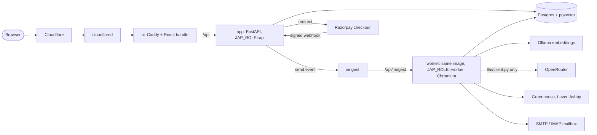
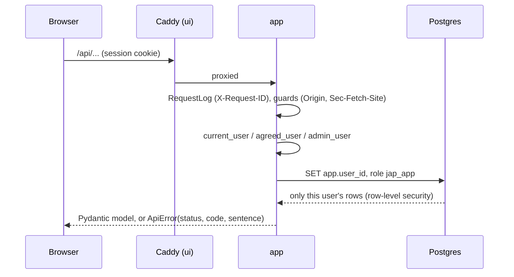
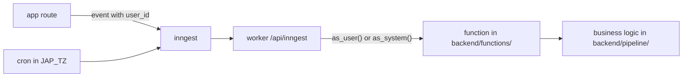

# Architecture

## Services



Live, as above. Locally there is no Cloudflare or tunnel: the browser reaches the Vite dev server
on :5173 and `app` on :8001 directly, Ollama runs natively on the Mac, and Adminer is added.

One Docker Compose stack (`infra/compose.yaml`), with a release overlay for live
(`infra/compose.release.yaml`).

| Service | What it is | local | live |
| --- | --- | --- | --- |
| `ui` | React 19 + Vite + TypeScript | Vite dev server, :5173 | built bundle served by Caddy, which also proxies `/api` and sends the CSP and HSTS (`infra/caddy/Caddyfile`) |
| `app` | FastAPI, `JAP_ROLE=api`: answers `/api`, does **not** mount `/api/inngest` | :8001 | behind Caddy |
| `worker` | the same image, `JAP_ROLE=worker`: runs the Inngest functions and Playwright Chromium; published nowhere | yes | yes |
| `inngest` | Inngest dev server / self-hosted Inngest, runs every background step | :8290 | own keys |
| `db` | Postgres 16 with pgvector, pg_trgm, pgcrypto | :5432 | 127.0.0.1 only |
| Ollama | `nomic-embed-text` embeddings for dedup | native on the Mac (GPU) | a container, CPU |
| `cloudflared` | Cloudflare Tunnel, one outbound connection to Caddy at `ui:8080` | no | yes |
| `adminer` | database browser | :8080 | **not in the stack** |

All host ports bind to 127.0.0.1. On live nothing listens on the internet: the firewall allows
SSH only and the tunnel is the way in.

`app` and `worker` are one image started twice so the endpoint that runs JAP's functions is
absent from the process a browser can reach, and so the browser-heavy work cannot starve the
API. More workers is a replica count.

## External services

| Service | Used for | Where in code |
| --- | --- | --- |
| OpenRouter | every model call (extract model `JAP_MODEL_EXTRACT`, writer model `JAP_MODEL_WRITE`) | `backend/llm/client.py` only |
| Greenhouse, Lever, Ashby public boards | reading jobs, filling and submitting forms | `backend/sources/`, `backend/pipeline/apply/` |
| SMTP / IMAP mailbox | Applied emails, alerts, reset and verify links; reading Greenhouse security codes | `backend/pipeline/notify.py`, `pipeline/apply/security_code.py` |
| Razorpay | Plus subscriptions (hosted checkout + signed webhook) | `backend/billing/` |
| Google OIDC | Sign in with Google (optional) | `backend/auth/oidc.py` |
| Cloudflare | tunnel, Turnstile on sign-up (optional), rate-limit rule on `/api/auth/*` | `infra/`, `backend/auth/turnstile.py` |
| Sentry | errors only, scrubbed (optional, `SENTRY_DSN`) | `backend/observability/sentry.py` |
| GitHub Actions + GHCR | CI; images built for a `v*` tag | `.github/workflows/` |

## Code layout

```
backend/
  main.py            app factory: middleware, the four route classes, Inngest mount on worker
  config.py          every setting (pydantic-settings, from .env); each also in .env.example
  api/               one router per file; handlers take the Session dependency
  schemas/           Pydantic request/response models
  auth/              accounts, sessions, passwords (scrypt), TOTP, OIDC, consent, guards,
                     rate limits, Turnstile, the CLI behind make set-password etc.
  database/          models.py, session.py, tenant.py (who a session is), migrations/ (Alembic,
                     0001 to 0021 on main)
  sources/           Greenhouse, Lever, Ashby readers and board detection
  pipeline/          the business logic: ingest, canonical, dedup, enrich, matching, runs,
                     apply/ (form reader, fields, answers, flow, security_code), cover_letter,
                     limits, notify, backup, erasure, retention, unfollow, storage, workspace
  functions/         Inngest functions, one per file, wiring only; ALL_FUNCTIONS in __init__.py
  llm/               call() (redact, guard, spend cap, log, validate), client.py, redact.py,
                     spend.py, secrets.py (BYOK sealing), prompts/<name>.v<N>.md
  billing/           provider boundary (providers.py), razorpay.py, service.py
  observability/     JSON logs, scrubbing, request log, Inngest middleware, health, insights,
                     capacity, alerts, Sentry
  tests/             pytest; fakes for OpenRouter, Ollama, Inngest and the job sites
frontend/src/
  App.tsx            shell, sidebar, version under the logo
  api/client.ts      all HTTP and every payload type
  pages/             one file per screen: Jobs, Profile, Preferences, Insights, Settings,
                     SignIn, Legal (terms and privacy notice), AccountSection
  store.tsx + *Context.ts   state, no state library
infra/               compose files, Dockerfiles, Caddyfile, env/live.env, postgres/init.sql,
                     scripts/ (deploy, server-setup, backup, restore, vm-sync, worktree,
                     agent-guard, check-tracked, agent-setup)
seed/                companies.yaml, skills.yaml
docs/                this folder; docs/intent/sources/ is the gitignored PRD and friends
```

## Data model: shared facts, private people

The split is the heart of multi-user JAP. **Facts about jobs are shared and fetched once;
everything about a person is private.**

| Shared (no `user_id`) | Private (`user_id` + row-level security) |
| --- | --- |
| `company`, `company_alias`, `watched_board`, `posting`, `listing`, `possible_duplicate`, `dedup_override`, `skill_alias`, `form_check` | `profile`, `resume_version`, `answer_bank`, `application`, `run`, `board_follow`, `user_listing`, `llm_call`, `user_secret`, `subscription` |

The private list is `PRIVATE_TABLES` in `backend/database/tenant.py`; a test checks the
database agrees, and export and erasure walk the same list, so a new private table cannot be
left out of either.

- `board_follow` is "this user follows this board"; `user_listing` is what a job is *to* one
  user (matched, skills match, status). They hold the personal half of what used to sit on
  shared rows.
- Accounts and service tables: `app_user`, `user_identity`, `auth_session`, `password_reset`,
  `email_verification`, `rate_limit`, `app_setting`, `billing_event` (no `user_id`, never the
  raw body), `log_event`, `route_stat`, `alert_state`.
- Enums worth knowing: application status `preparing`, `ready_for_review`, `applying`,
  `applied`, `needs_input`, `failed`, `cancelled`; apply mode `review`, `automatic`; run
  status `queued`, `running`, `succeeded`, `failed`.
- An `applied` application is frozen by a trigger (A2); only the erasure transaction may
  delete one.

## How a request moves



Browser → Cloudflare → `cloudflared` → Caddy (`ui`) → `app` `/api/...`

1. `RequestLog` gives it an `X-Request-ID` and times it; `guards` refuse a write that began
   on another site (`Origin`, `Sec-Fetch-Site`).
2. The router's dependency decides who it is for (`backend/auth/deps.py`):
   `current_user` (signed in, verified, not turned off), `agreed_user` (and agreed to the
   current notice), `admin_user` (and is the admin; otherwise 404).
3. The dependency puts the session in that user's tenant: each transaction runs as role
   `jap_app` with `app.user_id` set, so row-level security shows only their rows.
4. The handler works through `pipeline/`, returns a Pydantic model, or raises
   `ApiError(status, code, sentence)`.

## How background work moves



A route sends an Inngest event; `inngest` calls `worker` at `/api/inngest`; the function's
tenant comes from the event (`observability/inngest_mw.py`) or is declared with `as_user()` /
`as_system()`.

| Function | Started by | Does |
| --- | --- | --- |
| `run-pipeline` | `run/requested` | one account's search: fetch its boards, dedup, match, optionally apply. Concurrency 1 per `user_id` under `JAP_MAX_PARALLEL_RUNS` |
| `fetch-board` | `board/fetch.requested` | read one board (shared), skip if fetched within `JAP_BOARD_FRESH_MINUTES` |
| `enrich-posting` | `posting/enrich.requested` | extract model reads one description once, billed to the service |
| `profile-saved` | `profile/saved` | re-filter, then a background search |
| `daily-schedule` | cron every minute | start each account's daily search in its own time zone |
| `parse-resume` | `resume/uploaded` | read a resume into skills and fields |
| `apply-listing` | `listing/apply.requested` | prepare and (when approved or automatic) submit one application; one browser per account under `JAP_APPLY_BROWSERS` |
| `notify-applied` | `application/submitted` | the "Applied: Role at Company" email |
| `notify-failure` | `run/failed`, `application/failed`, `form-check/failed` | alert emails |
| `daily-backup` | hourly cron, `backup/requested` | `pg_dump`, first time each day, 14 days kept |
| `form-check` | Monday 07:00, `form-check/requested` | read one live form per ATS, submit nothing |
| `health-watch` | hourly at :40, `health/check-requested` | delete old log rows, sweep old traces and screenshots, send health alerts |
| `ping` | `system/ping` | smoke test |

Crons run in `JAP_TZ` (default `Asia/Kolkata`).
